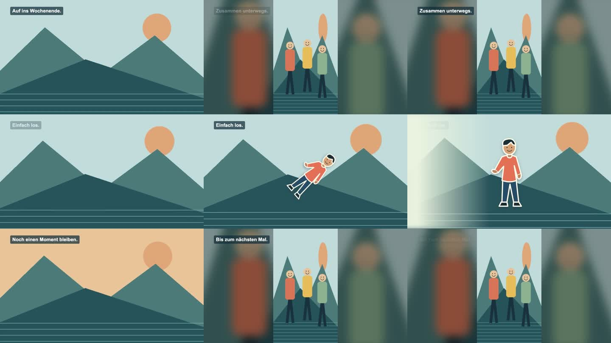
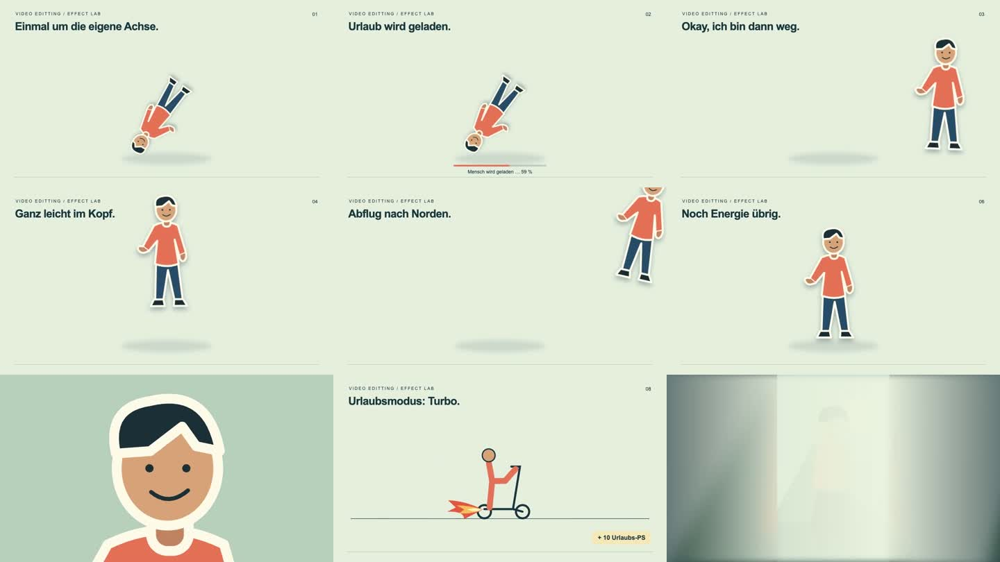

# VideoEditting — Filme mit Gefühl, Rhythmus und Quatsch

Ein deutschsprachiger Werkzeugkasten für LLM-gestützte Roadtrip-Filme, Freundschafts-Recaps und kurze Reels. Aus echten Schnittkorrekturen entstanden: Metadaten statt Dateisortierung, hörbare Beats statt beliebiger Peaks, vollständige Gesichter statt automatischer Crops und gezielte Comedy statt beliebiger Effekte.

**Hier anfangen:** [SETUP.md — Skills und MCPs auswählen](SETUP.md). Danach folgt [START_HERE.md — den Film planen](START_HERE.md). Das Repo liefert Arbeitswissen, Vorlagen, Prüfprogramme und einen ausführbaren Remotion-Effektbaukasten. Die kreative Auswahl und Sicht-/Hörkontrolle bleiben notwendig; ein Prompt garantiert keinen perfekten Film.

## Die ersten Nachrichten

1. **Skills:** „Möchtest du alle Skills installieren/übernehmen, nur bestimmte auswählen oder zunächst nur die Anleitung nutzen?“ Host und Zielprojekt werden nur ergänzt, wenn noch unbekannt.
2. **MCPs:** Das LLM prüft vorhandene Tools und schlägt wenige passende Ergänzungen vor: „Soll ich diese MCPs einrichten, einzelne davon oder keine zusätzlichen?“ Zweck, Zugang und Installationsort werden vorher benannt.
3. **Danach:** Filmstil, Humor, Länge, Format, Medien und Musik.

Ein vollständiger Klon enthält die Projekt-Skills bereits. Dann geht es um ihre Nutzung oder Übernahme in ein anderes Projekt. Bereits beantwortete Fragen werden nicht wiederholt; zusätzliche MCPs sind optional. [Beispieldialog und Ablauf](SETUP.md) · [MCP-Kandidaten](skills/video-setup/references/integrations.md) · [Recherche vergleichbarer Repos](docs/onboarding-research.md).

## An dein LLM weitergeben

Repo klonen oder ZIP herunterladen und zusammen mit den eigenen Medien lokal öffnen. Diesen Auftrag einsetzen:

> Lies zuerst SETUP.md und AGENTS.md. Prüfe mein vorhandenes Setup. Frage mich zuerst, ob alle oder ausgewählte Skills übernommen werden sollen, und welche passenden MCPs ich zusätzlich installieren/verbinden möchte. Übernimm bekannte Antworten, führe die gewählte Einrichtung aus und prüfe sie. Danach lies START_HERE.md und kläre fehlende Filmwünsche. Meine Medien liegen in [lokaler Ordner], mein Ziel ist [Film/Reel]. Erstelle eine neue bearbeitbare Version mit Vorschau. Private Medien bleiben lokal.

Ein Chat ohne Dateizugriff kann daraus einen Schnittplan erstellen; zum Bauen braucht das LLM eine lokale Arbeitsumgebung oder einen passenden Editor. Ein GitHub-Link allein gibt ihm keinen Zugriff auf deine Fotos.

## Skills für Codex und Claude

**Zehn eigenständig nutzbare Skills:** Einrichtung, Filmschnitt, Filmbriefing, Beatcut, Bildauswahl, Hochformat/Blur, Comedy, Tonmischung, Chronologie und Exportkontrolle. Codex findet die Projektkopien unter `.agents/skills/`, Claude Code unter `.claude/skills/`. Öffne das geklonte Repo als Arbeitsprojekt. Erster Einstieg in Codex CLI/IDE: `$video-setup`; in Claude Code: `/video-setup`. Für den anschließenden Schnitt: `video-editing`. [Installationsdetails und offizielle Quellen](docs/skills.md).

Für Claude mit Skill-Upload gibt es [einzelne ZIP-Pakete](dist/skills/). Für ein anderes lokales Projekt:

```sh
python3 tools/manage_skills.py install --target both --project /pfad/zum/videoprojekt
```

Der Installer unterstützt `status`, `--dry-run` und einzelne `--skill`-Auswahlen; abweichende vorhandene Skills bleiben erhalten. MCPs werden getrennt ausgewählt und eingerichtet. **Nach dem Setup** kann `python3 tools/brief.py local/project-v001/brief.json` den Filmbriefing-Assistenten starten. Unbekannte Angaben bleiben sichtbar offen.

## Ein vollständiger Film aus einer Timeline

Der [durchgängige Schnellstart](docs/end-to-end.md) erzeugt eigene Testmedien, Kontaktbögen, Ähnlichkeitsgruppen und Beat-Kandidaten und rendert eine bearbeitbare JSON-Timeline bis zum geprüften MP4. Für eigene Medien werden dieselben Werkzeuge verwendet. Mit `python3 tools/film.py doctor` zunächst die lokalen Voraussetzungen prüfen.

[18-Sekunden-Beispiel ansehen](examples/pipeline-preview.mp4) · [Materialauswahl mit Duplikaten](docs/assets/pipeline-selection.jpg) · [Prüfbericht](docs/pipeline-qa.json)



## Ausführbare Beispiele

Voraussetzungen: Node.js 22 oder 24, npm; Python 3.9+ für die Prüfwerkzeuge. FFmpeg/ffprobe für Exportanalyse, ExifTool für die echte Medieninventur.

```sh
git clone https://github.com/DomCamillo2/VideoEditting.git
cd VideoEditting
python3 -m unittest discover -s tests -v
python3 tools/editing.py validate examples/timeline.json
cd studio
npm ci
npm run lint
npm run dev -- --no-open
```

Öffne die vom Studio ausgegebene lokale URL. **EffectsLab** zeigt Freisteller-Spins, Download, Davonlaufen, Schweben, Raketenstart, Sprungfeder, Gesichts-Zoom, Flammen und einen Wischübergang. **PortraitFraming** demonstriert einen vollständigen Vordergrund mit demselben Motiv als weichem Hintergrund. Alle Demo-Motive sind eigens erstellte SVGs; echte Personen müssen individuell freigestellt werden.

[Demo ohne Installation ansehen/herunterladen](examples/effects-lab.mp4) · [visuelle Übersicht](docs/assets/effects-overview.jpg)



## Wegweiser

| Ziel | Einstieg |
|---|---|
| Neuer Film oder bestehender Schnitt | [Workflow](docs/workflow.md), [Briefing](templates/brief.md) |
| Codex-/Claude-Skills installieren | [Skills und Stilwahl](docs/skills.md) |
| Gute Bilder statt fünf ähnlicher | [Medienauswahl](docs/media-selection.md), [Auswahl-Skill](skills/video-select-media/SKILL.md) |
| Chronologie und unsichere Route | [Metadaten und Karten](docs/metadata-routes.md) |
| Musik, Beats, Originalton | [Musik und Beatcut](docs/music-beats.md) |
| Mehr lustige Dinge | [Comedy-Kochbuch](docs/comedy.md), [ausführbarer Baukasten](studio/README.md) |
| Übergänge wie in schnellen Edits | [Übergänge](docs/transitions.md), [Motion-Recherche](docs/motion-research.md) |
| Hochformat und Reels | [Framing](docs/framing.md), [Reels](docs/reels.md) |
| Vorschau und fertiger Export | [QA und Rendering](docs/qa-render.md), [Werkzeuge](tools/README.md) |
| Erfahrungen und bekannte Fehler | [Fallstudien](docs/learnings.md), [Provenienz](docs/provenance.md) |
| Weitere wichtige Schnittentscheidungen | [Recherche: Auswahl, Ton und Qualität](docs/editing-research.md) |
| An anderes LLM übergeben | [Handoff](templates/handoff.md), [Agent-Skill](skills/video-editing/SKILL.md) |
| Repository-Audit und Erkenntnisse anderer Schnittwerkzeuge | [Audit und Vergleich](docs/repository-audit.md) |
| Songs lokal nutzen | [Musikverzeichnis](music/README.md) |

## Was geteilt wird

Code, allgemeine Erkenntnisse, eigene synthetische Beispiele und Referenzlinks. Fremde Songs sind nicht enthalten. Musik für eigene Projekte, private Fotos, Rohvideos, Chatprotokolle und GPS-Kataloge gehören in `local/` bzw. `studio/public/local/` und sind von Git ausgeschlossen. [Rechte und Abhängigkeiten](NOTICE.md).

Stand der Recherche: **11. Oktober 2026**. Der Starter pinnt Remotion 4.0.534; Web-Dokumentation kann inzwischen andere APIs zeigen. [Prüfstand](docs/validation.md).
